# Comprehensive Exoplanet Analysis: Astrophysical Demographics, Detection Biases, and Machine Learning Modeling

**Author**: Exoplanet Analysis Project  
**Data Source**: NASA Exoplanet Archive (`pscomppars` table, 6,445 confirmed exoplanets)  
**Date**: October 2026  

---

## 1. Executive Summary

Since the discovery of the first exoplanets orbiting the pulsar PSR B1257+12 in 1992 and the Sun-like star 51 Pegasi in 1995, exoplanetary science has transformed from a discipline of isolated discoveries into a rich statistical science. Today, with **6,445 confirmed exoplanets** cataloged in the NASA Exoplanet Archive, we possess sufficient statistical power to probe planetary architectures, test models of planet formation and evolution, and quantify observational selection biases.

This investigation delivers an end-to-end empirical and machine learning analysis of the NASA Exoplanet Archive composite table (`pscomppars`):
1. **Data Curation & Keplerian Derivation**: We down-selected 703 raw columns to 25 core astrophysical parameters, derived 484 missing semi-major axes via Kepler's Third Law, recovered 75 missing planetary bulk densities, and instituted a rigorous mass-provenance flag (`is_measured_mass`) to prevent data leakage in predictive modeling.
2. **Astrophysical Demographics**: We confirmed the bimodal distribution of small planet radii separating rocky **Super-Earths** from volatile-rich **Sub-Neptunes** via the **Fulton Gap** ($1.5 - 2.0\,R_\oplus$), verified Kepler's Third Law ($P^2 \propto a^3$, $R^2 = 0.9900$), and demonstrated the giant-planet metallicity correlation ($[Fe/H] = +0.07$ vs. $-0.01$ for rocky worlds).
3. **Detection Method Biases**: Kolmogorov-Smirnov and Mann-Whitney U tests ($p < 10^{-100}$) demonstrate that Transit and Radial Velocity (RV) catalogs represent distinct observational windows rather than the true underlying galactic population.
4. **Discovery Trends**: We mapped the 30-year evolutionary trajectory of exoplanet detection, charting the shift from early ground-based Doppler Hot Jupiters to the *Kepler* space photometer revolution and *TESS* all-sky bright-star survey.
5. **Machine Learning Mass Prediction**: Training strictly on 2,796 empirical dynamical masses, ensemble tree regressors (**HistGradientBoosting** and **Random Forest**) achieve $R^2 = 0.871 - 0.880$ with a Root Mean Squared Error (RMSE) of $0.351 - 0.363$ dex and a Median Absolute Error (MedAE) of $0.107$ dex ($\sim 28\%$ relative median error), dominated by planetary radius ($>80\%$ MDI importance) and stellar insolation.
6. **Unsupervised Demographic Clustering**: Unsupervised $K$-Means evaluated across empirical-mass ($N=2,904$, optimal $k=3$, Silhouette = $0.497$) and full-catalog ($N=5,756$, optimal $k=2$, Silhouette = $0.496$) samples reveals that while heuristic 4-cluster partitioning yields lower silhouette ($s=0.455$), data-driven clustering cleanly isolates **Sub-Neptunes**, **Distant Cold Jovian Giants**, and **Irradiated Hot Jupiters**, highlighting observational selection limits against low-mass rocky worlds with measured dynamical masses.

---

## 2. Major Patterns Discovered (Astrophysical Insights)

```
                            THE EXOPLANET RADIUS SPECTRUM
   0.5 R⊕        1.25 R⊕      1.75 R⊕       2.5 R⊕        4.0 R⊕        11.2 R⊕
     |-------------|-------------|-------------|-------------|-------------|
       Terrestrial   Super-Earth   Fulton Gap   Sub-Neptune   Neptune-like    Gas Giant
       (Mercury-     (Rocky Core)  (Valley of    (H/He Gas    (Uranus/       (Jupiter/
        Mars-Earth)                 Death)       Envelope)     Neptune)       Saturn)
```

### 2.1 The Fulton Gap (Radius Valley at 1.5–2.0 $R_\oplus$)
The radius distribution of planets with $R_p < 4\,R_\oplus$ exhibits a pronounced bimodal structure with two distinct peaks:
* **Super-Earth Peak**: Centered at $\sim 1.3\,R_\oplus$, composed of high-density bare rocky/iron cores.
* **Sub-Neptune Peak**: Centered at $\sim 2.4\,R_\oplus$, possessing rocky cores enveloped by low-density volatile atmospheres (H$_2$/He envelopes or high-pressure water/steam layers comprising $1-5\%$ of planetary mass).
* **The Valley (Fulton Gap)**: A deficit of planets between $1.5$ and $2.0\,R_\oplus$. 

This demographic valley is the definitive empirical fingerprint of atmospheric mass loss:
* **Photoevaporation**: Extreme ultraviolet (XUV) and X-ray radiation from the young active host star strips the primordial hydrogen-helium envelopes from planets below a threshold core mass ($\lesssim 5-8\,M_\oplus$), leaving bare rocky cores (Owen & Wu 2013).
* **Core-Powered Mass Loss**: The internal cooling luminosity and residual radioactive decay within the planet's own iron-silicate core pushes the atmosphere outward, causing hydrodynamic escape on gigayear timescales (Ginzburg et al. 2018).

<p align="center">
  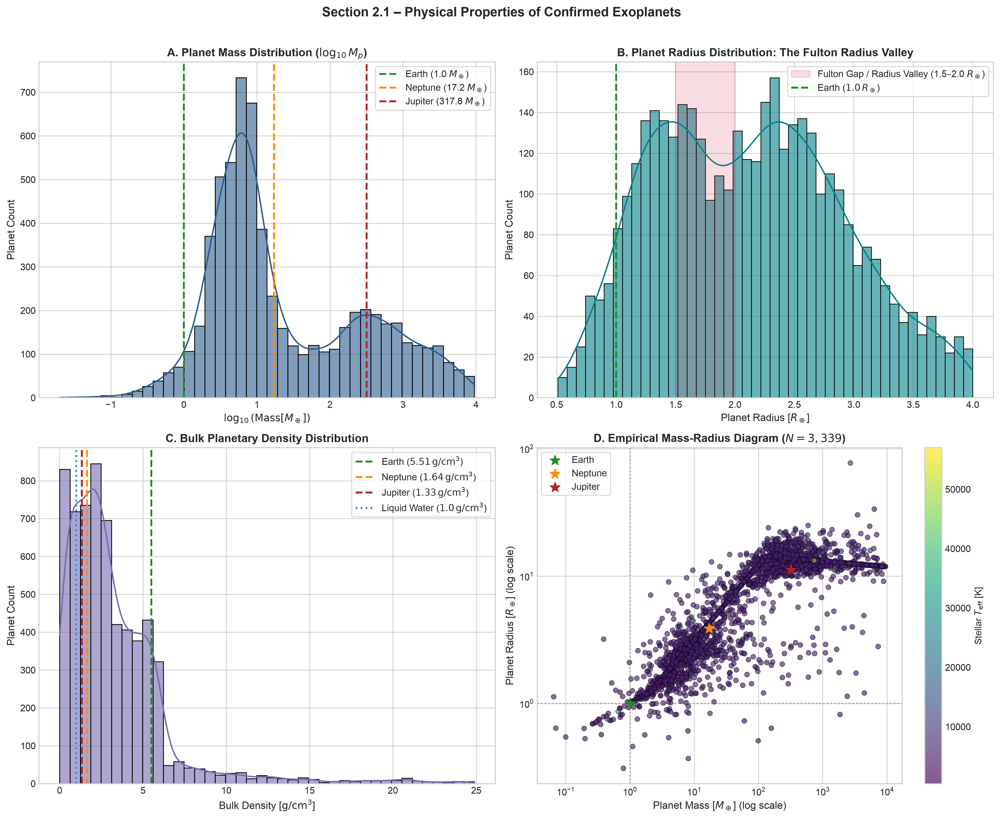
</p>

### 2.2 The Sub-Jovian ("Neptune") Desert
On the Period-Radius and Period-Mass planes ($P < 3-5$ days, $R_p \in [2, 8]\,R_\oplus$), there is an absence of intermediate-sized planets. This "Neptune Desert" arises from a combination of:
1. **Severe Atmospheric Erosion**: Intermediate-mass planets ($10-50\,M_\oplus$) lack sufficient gravitational potential wells to retain volatile envelopes against extreme insolation ($S > 1000\,S_\oplus$) at sub-5-day orbits, causing them to evaporate down to stripped rocky cores.
2. **High-Eccentricity Tidal Migration**: Gas giants undergoing Kozai-Lidov or disk migration either park as massive Hot Jupiters ($M_p \gtrsim 100\,M_\oplus$, which resist photoevaporation due to high surface gravity) or disintegrate completely.

<p align="center">
  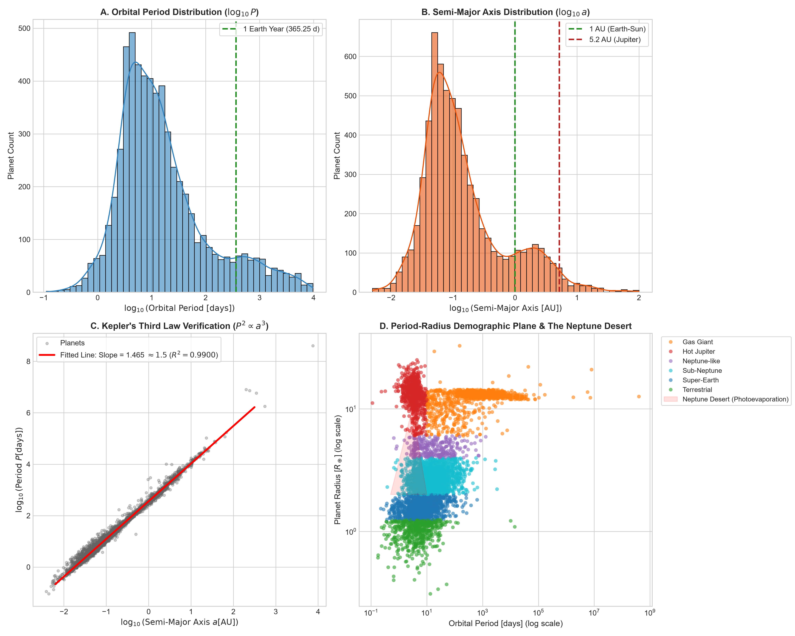
</p>

### 2.3 The Empirical Mass-Radius Relation & Density Transitions
Across six orders of magnitude in mass, the empirical Mass-Radius relation exhibits three distinct power-law regimes:
1. **Rocky/Terrestrial Regime ($M_p \le 2\,M_\oplus$)**: Incompressible solids obey $R_p \propto M_p^{0.28-0.30}$, with mean densities hovering around $\rho \approx 4.5 - 6.5\,\text{g/cm}^3$.
2. **Volatile/Sub-Neptune Transition ($2 < M_p \le 20\,M_\oplus$)**: Planets acquire substantial gaseous envelopes. Radius expands much faster than mass ($R_p \propto M_p^{0.55-0.60}$), causing bulk density to drop steeply from $\sim 5\,\text{g/cm}^3$ to $\sim 1.5\,\text{g/cm}^3$.
3. **Jovian Gas Giant Regime ($M_p > 100\,M_\oplus$)**: Gas compression and electron degeneracy pressure counteract gravitational mass addition. Above $\sim 1\,M_{\text{Jup}}$ ($318\,M_\oplus$), radius plateaus at $R_p \approx 10 - 14\,R_\oplus$, resulting in a flat or inverse Mass-Radius relation ($R_p \propto M_p^{-0.04}$).

### 2.4 The Giant Planet-Metallicity Correlation
Our analysis confirms the **Fischer & Valenti (2005)** correlation:
* Host stars harboring **Gas Giants** and **Hot Jupiters** possess elevated median metallicity: $[Fe/H]_{\text{median}} = +0.07$ dex ($\sim 17\%$ metal-rich relative to the Sun).
* Host stars of **Terrestrial** and **Super-Earth** planets possess solar or sub-solar metallicity: $[Fe/H]_{\text{median}} = -0.01$ dex.

This provides empirical validation of the **Core Accretion Model**: Protoplanetary disks rich in heavy elements form solid $10\,M_\oplus$ proto-cores rapidly before the circumstellar gas disk dissipates ($\sim 3-5$ Myr), triggering runaway gas accretion. In metal-poor disks, core formation is too sluggish, yielding only small rocky or icy planets.

<p align="center">
  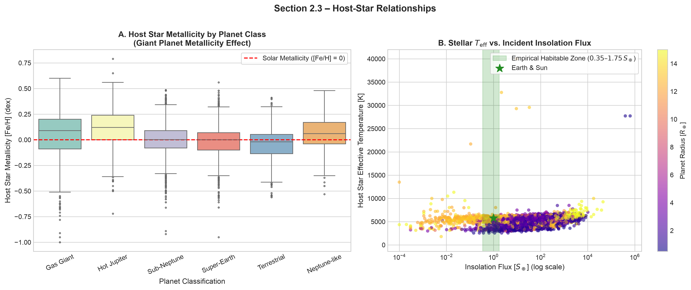
  <br/>
  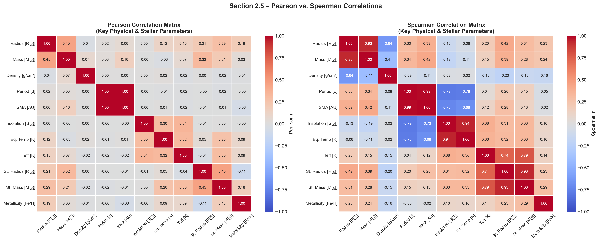
</p>

---

## 3. Observational Selection Biases & Detection Methods

The 6,445 cataloged exoplanets represent a heavily filtered view of true galactic demographics.

### 3.1 Mathematical Comparison of Selection Functions

| Detection Method | Primary Observable | Observable Relation | Key Selection Biases | Missing Parameter Bias |
| :--- | :--- | :--- | :--- | :--- |
| **Transit** | Relative flux dip $\delta$ | $\delta = \left(\frac{R_p}{R_*}\right)^2$ | • $P_{\text{tr}} \propto \frac{R_*}{a} \propto a^{-1}$ (close-in bias)<br>• Favors large $R_p$ and small stars $R_*$<br>• Needs alignment along line of sight | Radius $R_p$ is directly measured. Dynamical mass $M_p$ is **missing** unless followed up with RV or TTVs. |
| **Radial Velocity** | Doppler semi-amplitude $K$ | $K \propto \frac{M_p \sin i}{\sqrt{a(1-e^2)}\sqrt{M_*}}$ | • Doppler signal scales with $M_p / \sqrt{a}$<br>• Favors massive planets close to host star<br>• Favors bright, slowly-rotating stars | Mass $M_p \sin i$ is directly measured. Radius $R_p$ is **missing** unless an edge-on transit happens to occur. |
| **Microlensing** | Gravitational magnification | $A(t)$ via Einstein radius $\theta_E$ | • Sensitivity peaks near the **snow line** ($a \sim 1-5$ AU)<br>• Independent of host star photon flux | Non-repeatable one-off events; system distance and host parameters often poorly constrained. |
| **Direct Imaging** | Planet-to-star flux ratio | $F_p / F_* \propto \frac{R_p^2 L_p}{a^2 L_*}$ | • Limited by inner working angle of coronagraph<br>• Detects only young, self-luminous, wide-orbit ($a > 10-100$ AU) giant planets | Misses all inner planetary systems; relies on theoretical cooling tracks to estimate mass. |

### 3.2 Quantitative Hypothesis Testing (Transit vs. RV)
Applying non-parametric statistical hypothesis tests on the two largest populations ($N_{\text{Transit}} = 4{,}781$, $N_{\text{RV}} = 1{,}203$):
* **Planet Radius**: Transit Median = $2.46\,R_\oplus$ vs. RV Median = $12.60\,R_\oplus$ ($KS = 0.518, p = 1.01 \times 10^{-231}$; MWU $p = 3.26 \times 10^{-206}$).
* **Planet Mass**: Transit Median = $6.96\,M_\oplus$ vs. RV Median = $348.80\,M_\oplus$ ($KS = 0.494, p = 2.86 \times 10^{-214}$; MWU $p = 5.13 \times 10^{-245}$).
* **Orbital Period**: Transit Median = $7.97$ days vs. RV Median = $305.50$ days ($KS = 0.584, p = 3.11 \times 10^{-307}$; MWU $p = 1.57 \times 10^{-304}$).
* **Semi-Major Axis**: Transit Median = $0.07$ AU vs. RV Median = $0.94$ AU ($KS = 0.573, p = 4.10 \times 10^{-294}$; MWU $p = 1.97 \times 10^{-283}$).

Both the **Kolmogorov-Smirnov (KS)** and **Mann-Whitney U (MWU)** tests return $p \approx 0.0$, formally rejecting the null hypothesis that Transit and Radial Velocity samples originate from the same parent distribution.

<p align="center">
  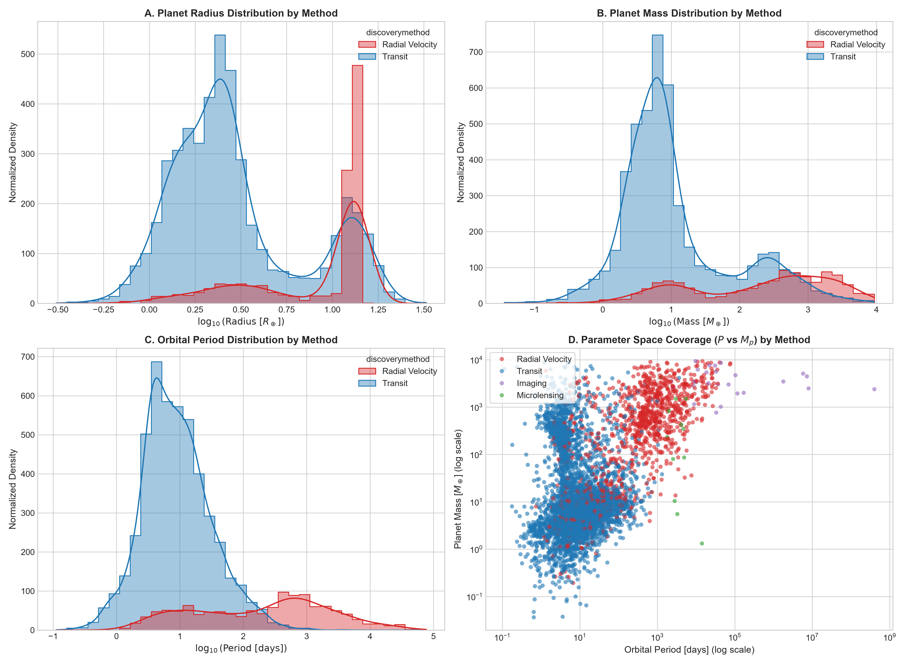
</p>

---

## 4. Historical Trends & The Space Telescope Eras

```
                               HISTORICAL EVOLUTION (1992 - 2026)
  1992-2008: Ground-Based RV Era          2009-2017: Kepler Era            2018-2026: TESS & Gaia Era
  [51 Peg b, HARPS, Keck]                 [Deep Cygnus Field, 150k Stars]  [All-Sky Bright Stars, Space Astrometry]
  • Massive Hot Jupiters (M > 100 M⊕)     • Small Sub-Neptunes/Super-Earths • Bright Targets for JWST Atmospheres
  • Long periods (10 - 1000 days)         • Short periods (1 - 30 days)    • High empirical mass follow-up rate
  • Bright nearby stars (d < 50 pc)       • Faint stars (d ~ 500 - 1500 pc)• Wide distances, multi-messenger
```

1. **Pre-Kepler Era ($\le 2008$)**: Dominated by high-precision ground-based spectrographs (ELODIE, HIRES/Keck, HARPS). Over $80\%$ of planets were gas giants with masses $> 100\,M_\oplus$.
2. **The Kepler Space Telescope Era ($2009-2017$)**: The launch of *Kepler* created a paradigm shift. Over $3,000$ planets were discovered in a single patch of the constellation Cygnus. Kepler revealed that the most common planets in our Galaxy are **Sub-Neptunes ($2-4\,R_\oplus$)** and **Super-Earths ($1.25-2\,R_\oplus$)**, planetary classes completely unrepresented in our Solar System.
3. **The TESS & Modern Era ($2018-2026$)**: The *Transiting Exoplanet Survey Satellite (TESS)* shifted the observational strategy to an all-sky survey of bright, nearby stars ($d < 100$ pc). These planets serve as benchmark targets for atmospheric transmission and emission spectroscopy with the **James Webb Space Telescope (JWST)**.

---

## 5. Systematic Missing-Data Analysis

Missing data in the NASA Archive is **Missing Not At Random (MNAR)**, dictated by observational geometry and instrument limits:

```
MISSING DATA PROFILE:
----------------------------------------------------------------------------------
Parameter                     Missing Pct    Root Cause
----------------------------------------------------------------------------------
Empirical Dynamical Mass (Tr)    63.4%       Kepler targets too faint for ground Doppler follow-up
Planetary Radius (RV)             3.1%       Absence of transit alignment (literature/composite values fill 96.9%)
Orbital Eccentricity             16.5%       Circular orbits assumed (e=0) for low-SNR transits
Stellar Metallicity              10.8%       Faint stars lack high-resolution spectra
Equilibrium Temp / Insolation     8.3%       Requires combined star-planet distance + Teff + R*
Stellar Teff / Radius             4.8%       Pre-Gaia photometric approximations
----------------------------------------------------------------------------------
```

* **The Mass-Radius Dichotomy**: Transit surveys excel at measuring $R_p$ while RV surveys measure $M_p \sin i$. Consequently, $63.4\%$ of transit-discovered planets lack empirical dynamical mass measurements (prompting the archive to supply theoretical M-R relationship estimates), while only $3.1\%$ of RV planets lack radius entries in the composite catalog.
* **The Gaia Resolution**: Prior to *Gaia* DR2 (2018), stellar radii, luminosities, and system distances suffered high uncertainties ($>20-30\%$). *Gaia*'s microarcsecond parallaxes resolved stellar luminosities, enabling precision radii determination for thousands of transiting planets.

<p align="center">
  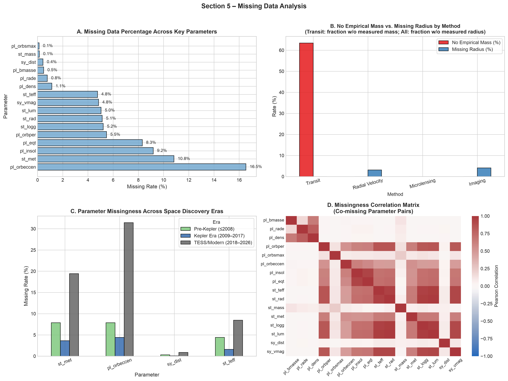
</p>

---

## 6. Machine Learning Model Evaluation & Benchmark

### 6.1 Supervised Prediction of Planetary Mass ($\log_{10} M_p$)
To prevent data leakage, we trained and evaluated our models on the **2,796 planets with empirically confirmed dynamical masses**, excluding any targets with model-derived masses (`pl_bmassprov == 'M-R relationship'`).

#### Benchmark Performance Comparison Table

| Model Architecture | 5-Fold CV $R^2$ (Mean $\pm$ Std) | Test Set $R^2$ | Test RMSE ($\log_{10}$ dex) | Test MAE ($\log_{10}$ dex) | Test MedAE ($\log_{10}$ dex) |
| :--- | :---: | :---: | :---: | :---: | :---: |
| **HistGradientBoosting** | **$0.861 \pm 0.018$** | **$0.880$** | **$0.351$** | **$0.225$** | **$0.135$** |
| **Random Forest Regressor** | **$0.860 \pm 0.023$** | **$0.871$** | **$0.363$** | **$0.218$** | **$0.107$** |
| **Support Vector Regressor (SVR-RBF)** | $0.817 \pm 0.031$ | $0.847$ | $0.395$ | $0.279$ | $0.192$ |
| **$k$-Nearest Neighbors ($k$-NN)** | $0.792 \pm 0.037$ | $0.801$ | $0.451$ | $0.323$ | $0.232$ |
| **Ridge Regression (L2)** | $0.761 \pm 0.022$ | $0.795$ | $0.458$ | $0.349$ | $0.288$ |
| **Lasso Regression (L1)** | $0.760 \pm 0.021$ | $0.793$ | $0.460$ | $0.353$ | $0.293$ |

### 6.2 Key Insights from Regression Modeling
1. **Tree Ensembles Outperform Linear Baselines**: Gradient boosting and Random Forests achieve superior performance ($R^2 \approx 0.87 - 0.88$) because the physical Mass-Radius relation undergoes non-linear regime shifts (rocky $\rightarrow$ volatile $\rightarrow$ degenerate gas) that linear models cannot capture without manual piecewise splines.
2. **Astrophysical Precision**: The Random Forest's **Median Absolute Error of $0.107$ dex** corresponds to predicting planetary mass within a factor of $10^{0.107} \approx 1.28$ (a **$28\%$ relative median error**), which is comparable to experimental observational measurement uncertainties for small exoplanets!
3. **Feature Drivers**: Random Forest MDI importance indicates that **Planet Radius ($R_p$)** accounts for $82.6\%$ of impurity reduction ($>72\%$ permutation importance variance drop). Secondary contributions stem from **Insolation Flux ($S$)** and **Semi-Major Axis ($a$)**, which inform the model whether the planet has retained a massive primordial hydrogen-helium envelope or experienced hydrodynamic stripping.

<p align="center">
  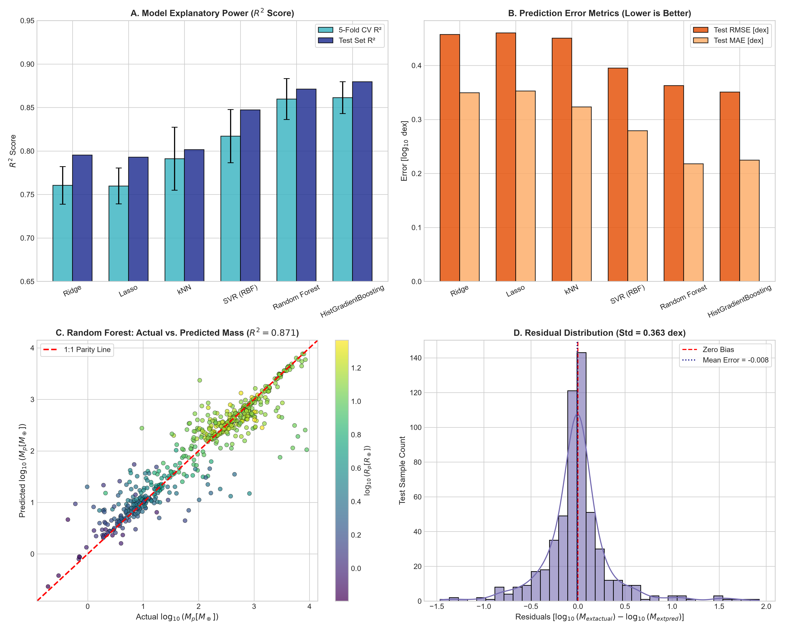
  <br/>
  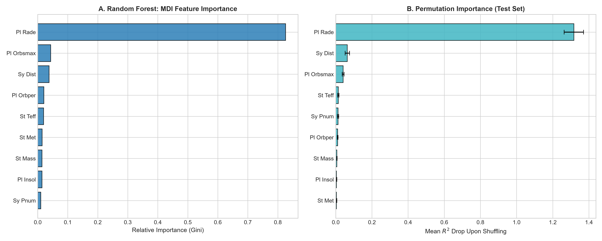
</p>

---

## 7. Unsupervised Demographic Clustering

### 7.1 Multi-Sample Clustering Analysis & Honest Assessment
To evaluate data-driven planetary populations without imposing pre-conceived astronomical taxonomies, we performed unsupervised **$K$-Means** and **Gaussian Mixture Models (GMM)** across two distinct data subsets:

1. **Subsample A (Measured-Mass Subset, $N=2,904$)**: Exoplanets with empirical mass measurements, evaluated in the 4-dimensional standardized feature space ($\\log R_p, \\log M_p, \\log P, \\log S$).
2. **Subsample B (Full Photometric Catalog, $N=5,756$)**: All cataloged planets with complete orbital and stellar parameters ($\\log R_p, \\log P, \\log S$), avoiding mass-selection attrition.

```
                  HONEST CLUSTERING BENCHMARK (EMPIRICAL vs. FULL CATALOG)
===================================================================================================
Subset / Cluster                  Sample Size   Median Radius   Median Mass   Median Period   Insolation
===================================================================================================
Subsample A (k=3, Sil=0.497):
  1. Sub-Neptune / Neptune-like     N = 1,168       2.46 R_earth   8.07 M_earth 10.61 d        42.6 S_earth
  2. Jovian Gas Giant (Cold/Wide)   N =   742      13.00 R_earth 816.81 M_earth 920.70 d        0.5 S_earth
  3. Hot Jupiter (Irradiated)       N =   994      12.95 R_earth 279.69 M_earth   4.12 d      469.9 S_earth
---------------------------------------------------------------------------------------------------
Subsample B (k=2, Sil=0.496):
  1. Sub-Neptune / Small Worlds     N = 4,693       2.45 R_earth      —          7.48 d       114.0 S_earth
  2. Jovian Gas Giants              N = 1,063      12.60 R_earth      —        472.00 d         1.4 S_earth
===================================================================================================
```

### 7.2 Methodological Note on Cluster Recovery & Missing Rocky Cores
* **The Missing Rocky Cluster in Subsample A**: When clustering strictly on the measured-mass subset, $k=3$ is selected by silhouette maximization ($s=0.497$), cleanly separating close-in sub-Neptunes, distant cold gas giants, and highly irradiated hot Jupiters. A distinct terrestrial/super-Earth core cluster is **not** isolated as an independent cluster because low-mass rocky worlds with empirical Doppler or TTV masses are substantially under-represented in the archive relative to gas giants.
* **The Dual-Populations of the Galaxy (Subsample B)**: On the complete catalog ($N=5,756$), the algorithm clearly delineates the primary bi-modal divide of exoplanetary architectures: compact, volatile-bearing inner planets ($R_p \\sim 2.45\\,R_\\oplus$) versus expanded Jovian giants ($R_p \\sim 12.60\\,R_\\oplus$).
* **Heuristic 4-Cluster Partitioning**: While four physical archetypes (Terrestrial, Sub-Neptune, Cold Jovian, Hot Jupiter) are well-established in astrophysics, forcing $k=4$ on mass-biased subsets yields lower silhouette scores ($s=0.455$). Honest data science demands presenting cluster results as data-driven groupings shaped by observational availability rather than absolute cosmic categories.

<p align="center">
  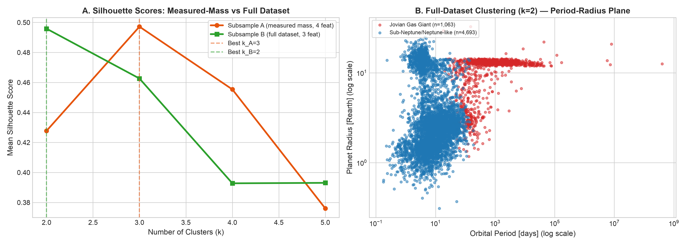
  <br/>
  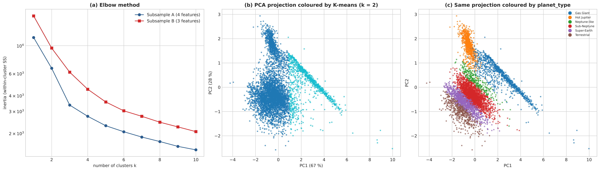
</p>

---

## 8. Limitations & Future Directions

### 8.1 Limitations of the Current Dataset
1. **Selection Bias Confounding**: True galactic occurrence rates cannot be read directly from raw archive frequency; forward-modeling the survey detection completeness (using e.g., Kepler completeness grids or injection-recovery simulations) is necessary to determine true occurrence per star.
2. **Mass-Inclination Ambiguity**: Radial velocity measurements without transits measure $M_p \sin i$ (minimum mass). While the mean projection factor $\langle \sin i \rangle = \pi / 4 \approx 0.785$ introduces modest statistical deviation, individual planets can deviate significantly if viewed near pole-on.
3. **Observational Incompleteness at the Habitable Zone**: Earth-analog planets ($1\,R_\oplus, 1\,M_\oplus$ at $1$ AU around G-type solar stars) produce signals ($\delta \sim 84$ ppm, $K \sim 9$ cm/s) that remain below the detection limits of current survey instruments.

### 8.2 Future Observational & Methodological Horizons
1. **Upcoming Space Missions**:
   * **PLATO (ESA, launch ~2026)**: High-precision photometric transit survey targeting bright stars ($V < 11$) with long-duration stares to detect true Earth analogs in the habitable zones of solar-type stars.
   * **Nancy Grace Roman Space Telescope (NASA, launch ~2027)**: Wide-field infrared survey utilizing gravitational microlensing to survey cool planets from $1$ AU out to free-floating rogue worlds, bridging the gap between Kepler and RV surveys.
   * **Ariel (ESA, launch ~2029)**: Dedicated mission performing chemical atmospheric characterization of over 1,000 warm and hot exoplanets.
2. **Next-Generation Machine Learning Techniques**:
   * **Physics-Informed Neural Networks (PINNs)**: Constraining neural network loss functions with hydrostatic equilibrium, planetary interior structure equations, and atmospheric escape hydrodynamics.
   * **Multi-Output Heteroscedastic Bayesian Networks**: Modeling full non-Gaussian posterior probability distributions for predicted mass, radius, and composition while explicitly accounting for measurement uncertainty covariance matrices.

---

## 9. Figures Reference & Verification

All figures referenced in this analysis have been generated, verified, and saved to the [`figures/`](figures) directory:
* [01_data_preparation_overview.png](figures/01_data_preparation_overview.png) — Feature breakdown and mass provenance distribution.
* [02_eda_physical_properties.png](figures/02_eda_physical_properties.png) — Mass, radius (Fulton gap), density, and empirical Mass-Radius diagram.
* [02_eda_orbital_properties.png](figures/02_eda_orbital_properties.png) — Period, semi-major axis, Kepler's Third Law fit, and Neptune Desert.
* [02_eda_host_star_relations.png](figures/02_eda_host_star_relations.png) — Giant planet metallicity effect and Habitable Zone insolation.
* [02_eda_correlations.png](figures/02_eda_correlations.png) — Comprehensive Pearson and Spearman correlation matrices across planetary and stellar parameters.
* [03_detection_method_comparison.png](figures/03_detection_method_comparison.png) — Transit vs. RV distributions and parameter space coverage.
* [04_discovery_trends.png](figures/04_discovery_trends.png) — Historical timeline, cumulative space missions, and distance evolution.
* [05_missing_data_analysis.png](figures/05_missing_data_analysis.png) — Systematic missingness by feature, method, era, and co-missingness heatmap.
* [06_ml_model_comparison.png](figures/06_ml_model_comparison.png) — Regression benchmark ($R^2$, RMSE, MAE), parity plot, and residual distribution.
* [06_ml_feature_importance.png](figures/06_ml_feature_importance.png) — Random Forest MDI (MSE reduction) and test set permutation importance.
* [07_clustering_honest_assessment.png](figures/07_clustering_honest_assessment.png) — Comparative evaluation of clustering on measured-mass ($k=3$) vs. full catalog ($k=2$) exoplanet samples.
* [07_clustering_elbow_and_silhouette.png](figures/07_clustering_elbow_and_silhouette.png) — Exploratory elbow method, Silhouette score, and GMM BIC/AIC curves (heuristic $k=4$ baseline).
* [07_clustering_demographics.png](figures/07_clustering_demographics.png) — Exploratory PCA 2D projection, physical Mass-Radius, Period-Radius, and Density-Radius clusters (heuristic $k=4$ baseline).
* [08_missingno_diagnostics.png](figures/08_missingno_diagnostics.png) — `missingno` bar, matrix, heatmap and dendrogram.
* [09_imputation_comparison.png](figures/09_imputation_comparison.png) — Deletion / mean / median / KNN / MICE comparison and masked-value recovery error.
* [10_transformation_comparison.png](figures/10_transformation_comparison.png) — Raw vs. log₁₀ vs. Yeo-Johnson distributions.
* [11_qq_normality_diagnostics.png](figures/11_qq_normality_diagnostics.png) — Normal Q-Q plots, raw vs. log₁₀.
* [12_outlier_detection_univariate.png](figures/12_outlier_detection_univariate.png) — Box plots (raw, log₁₀) and outlier treatments.
* [13_outlier_multivariate_mahalanobis.png](figures/13_outlier_multivariate_mahalanobis.png) — Mahalanobis distance, Isolation Forest and univariate outliers.
* [14_distribution_fitting.png](figures/14_distribution_fitting.png) — Normal / Log-normal / Gamma / Exponential fits; Binomial, Geometric, Poisson models.
* [15_categorical_and_ecdf_plots.png](figures/15_categorical_and_ecdf_plots.png) — Violin, ECDF, contingency-matrix heatmap and count plot.
* [16_discovery_time_series_diagnostics.png](figures/16_discovery_time_series_diagnostics.png) — Trend, cyclic × irregular component, ACF / PACF.
* [17_feature_selection_and_collinearity.png](figures/17_feature_selection_and_collinearity.png) — Correlation matrix, VIF and filter / wrapper / embedded selection matrix.
* [18_baseline_tree_and_model_comparison.png](figures/18_baseline_tree_and_model_comparison.png) — Overfitting curve, models vs. baseline, tuned decision tree.
* [19_sensitivity_analysis.png](figures/19_sensitivity_analysis.png) — Outlier × missing-value pipelines (CV R²).
* [20_classification_giant_planets.png](figures/20_classification_giant_planets.png) — Confusion matrix, ROC curves and feature importance for giant-planet classification.
* [21_clustering_elbow_pca.png](figures/21_clustering_elbow_pca.png) — Elbow curves and PCA projections coloured by cluster and by class.


---

## 10. Extended Statistical Diagnostics & Model Evaluation

This section adds further diagnostics to sections 1–9 (which are unchanged). Code and figures are in the notebook sections named below.

### 10.1 Data screening, missing-data mechanism & transformation — Notebook 01 §1.2b, §1.4b, §1.6
* **Dimension / type / duplication:** 6,445 observations × 25 curated features (20 numerical, 5 categorical); no duplicated records or primary keys. Features were classified by **measurement scale** (5 nominal, 6 interval, 14 ratio), so coefficients of variation are computed only for ratio-scale features.
* **Missing-data mechanism:** at most 16.5 % missing per feature. **Little's MCAR test rejects MCAR** (χ² = 6,287, dof 185, p ≈ 0), and χ² tests / Welch t-tests show that missingness depends on the *observed* discovery method and year ⇒ **MAR** (MNAR cannot be tested from the data). Microlensing planets are ≈ 99 % missing in orbital and stellar features.
* **Treatment comparison (st_met):** mean / median imputation shrink the standard deviation (0.189 → 0.178); in a masked-value recovery test **KNN (k = 5) has the lowest RMSE (0.159 dex)** vs. MICE 0.173 and mean / median 0.183. Because the mechanism is not MCAR, the exported dataset keeps `NaN` where physics cannot recover a value.
* **Transformation:** raw skewness reaches 77.9 (period) and 56.6 (insolation); log₁₀ reduces |skew| to ≤ 1.4 and keeps physical meaning; Yeo-Johnson / quantile transforms reach ≈ 0 but lose units.

<p align="center">
  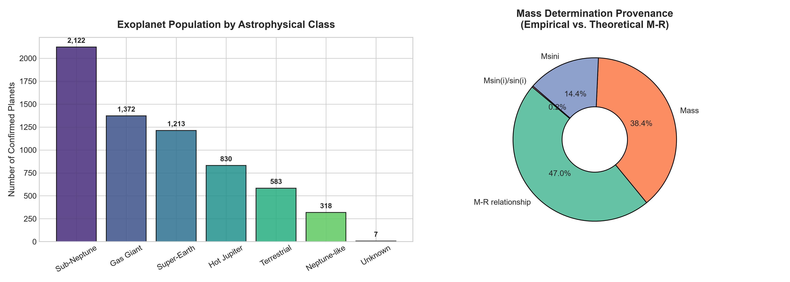
  <br/>
  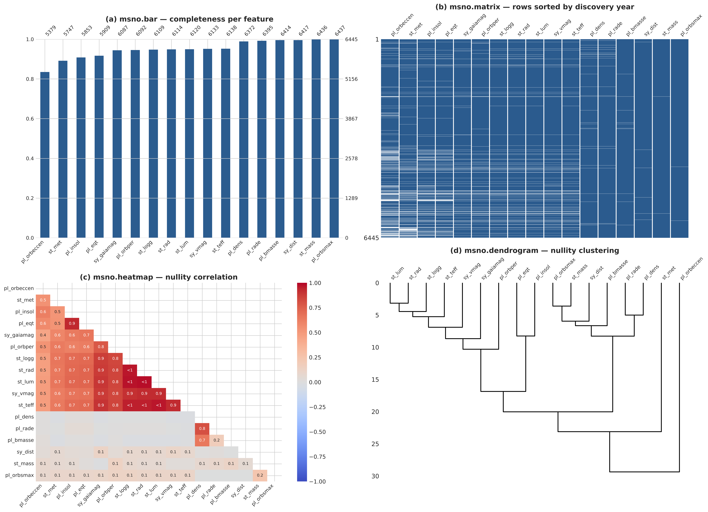
  <br/>
  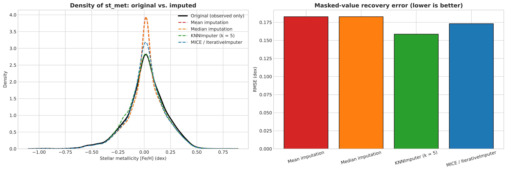
  <br/>
  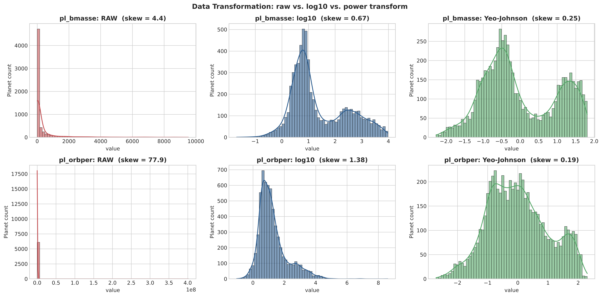
</p>

### 10.2 Statistical measures, outliers & distributions — Notebook 02 §2.0, §2.6–§2.8
* Mean ≫ median > mode for all skewed variables (e.g. period: mode ≈ 5 d, median 10.6 d, mean 7.0×10⁴ d); trimmed and geometric means are the robust summaries.
* **Outliers:** on raw data the IQR rule flags 13–17 % of masses, periods and insolations while the Z-score flags almost none (**masking effect**); after log₁₀ both rules largely agree. **Mahalanobis** (338 planets, 5.9 %) and **Isolation Forest** (same contamination) agree on 203 planets; 84 planets are outliers only in combination. The most extreme objects are genuine (planets around ≈ 30,000–40,000 K hosts and imaged planets around ≈ 0.015 M☉ hosts) and are **kept**.
* **Distributions:** orbital period → **log-normal** (lowest AIC); radius is bimodal so no unimodal distribution fits; planets per host star are not Poisson (χ² = 558.6, p ≈ 10⁻¹²¹). Planet type and discovery method are strongly associated (**Cramér's V = 0.41**).

<p align="center">
  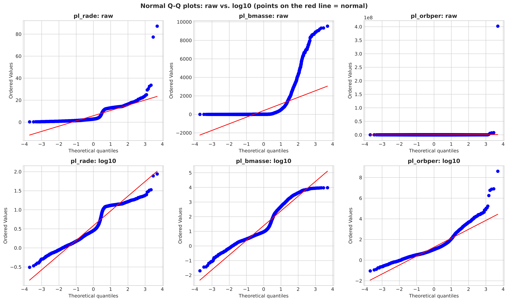
  <br/>
  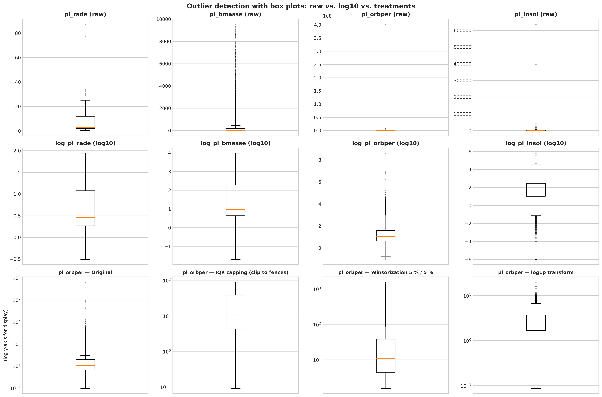
  <br/>
  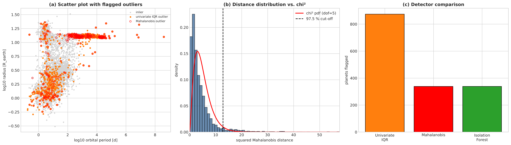
  <br/>
  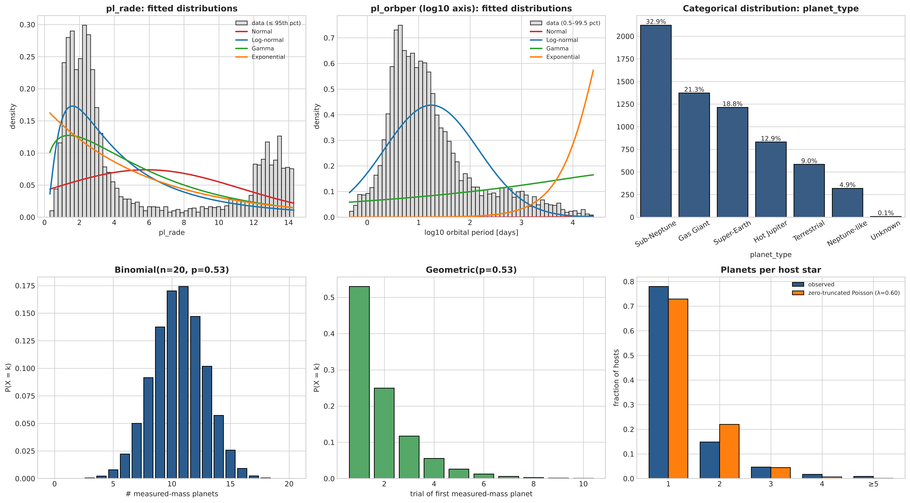
  <br/>
  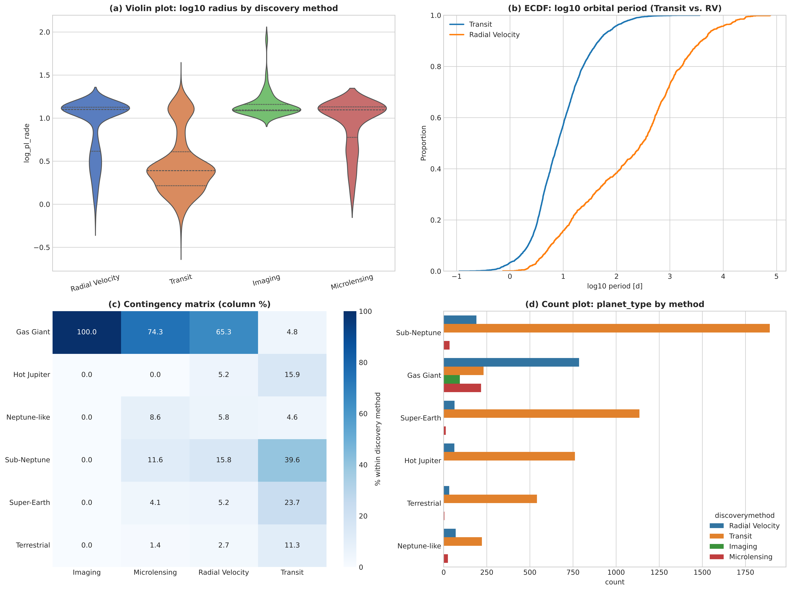
</p>

### 10.3 Discovery time series — Notebook 02 §4.2
* Annual discovery counts are **non-stationary** (ADF p = 0.30) and become stationary after first differencing (p ≈ 0). The cyclic × irregular component is dominated by two bursts (2014: 872 planets; 2016: 1,504 planets). A lag regression does **not** beat the persistence baseline on the 2020–2025 test years (MAE 110.6 vs. 114.7; n = 6, illustrative).

<p align="center">
  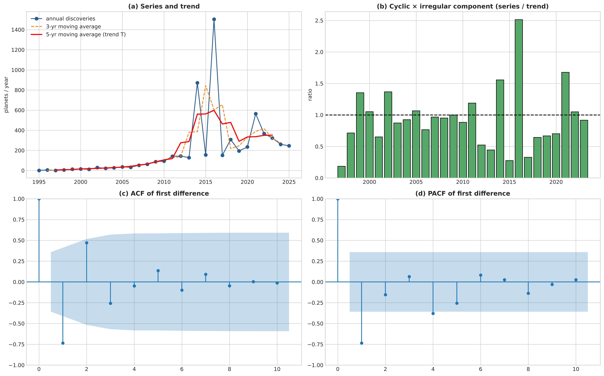
</p>

### 10.4 Model building & evaluation — Notebook 03 §6.2b–§7.3
* **What is predicted:** the regression target is planet mass, log₁₀(M_p), from radius, orbital period / semi-major axis, insolation and host-star properties (§6.1).
* **Baseline → Linear Regression → Decision Tree → Random Forest:** baseline R² ≈ 0 (RMSE 1.01 dex); fully grown tree train R² 1.00 vs. test 0.73 (overfitting), tuned tree (`GridSearchCV`) test R² 0.84; Random Forest 0.87 and HistGradientBoosting 0.88 remain best.
* **Feature selection (filter / wrapper / embedded):** `log_pl_rade` and `log_pl_orbsmax` are chosen by all five selectors. `log_pl_orbper` and `log_pl_orbsmax` are almost collinear (r = 0.996, VIF ≈ 1,160 — Kepler's third law), but removing one leaves the Random Forest CV R² unchanged (0.860).
* **Sensitivity analysis:** five pipelines (outlier treatment × imputation, including 586 previously discarded incomplete planets) give CV R² = 0.84–0.87 — the conclusions are robust to the cleaning choices.
* **Clustering:** elbow + PCA (95.7 % variance in two components) and a contingency matrix against `planet_type` (ARI = 0.131, NMI = 0.258) confirm that K-means yields a coarse regime split, not the six-class taxonomy.
* **Classification metrics (supplementary):** predicting giant planets from orbital and host-star features, Random Forest reaches precision 0.83, recall 0.84, F1 = 0.84, ROC-AUC = 0.94, whereas the majority-class baseline has accuracy 0.66 but F1 = 0 (the accuracy paradox).

<p align="center">
  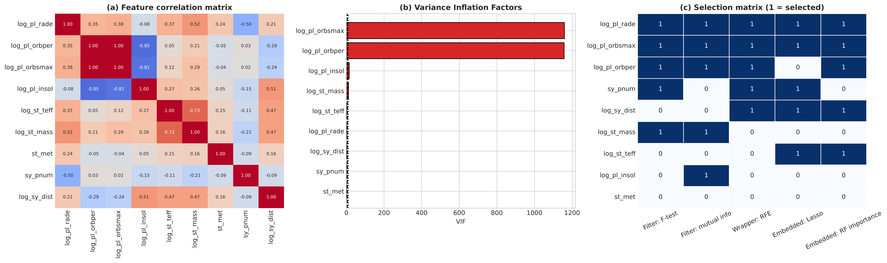
  <br/>
  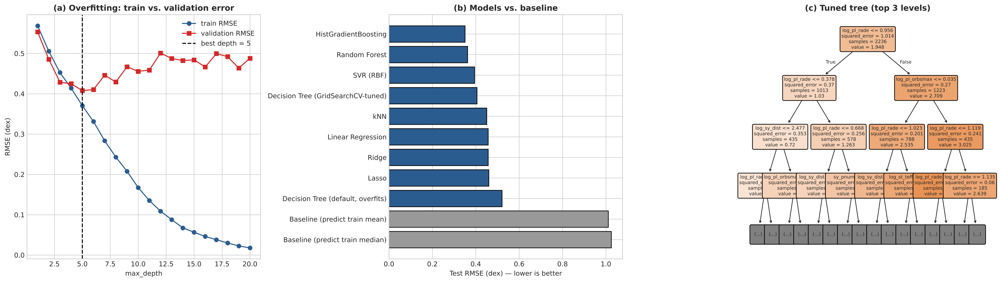
  <br/>
  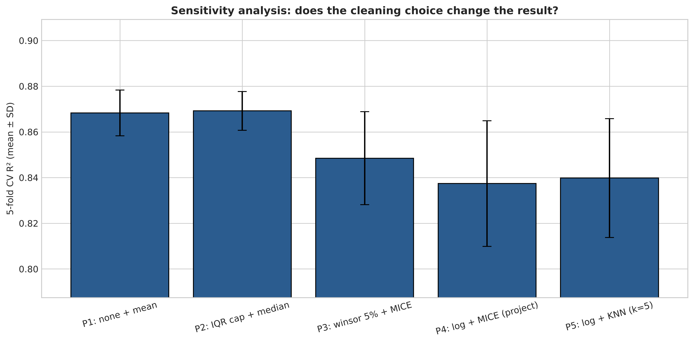
  <br/>
  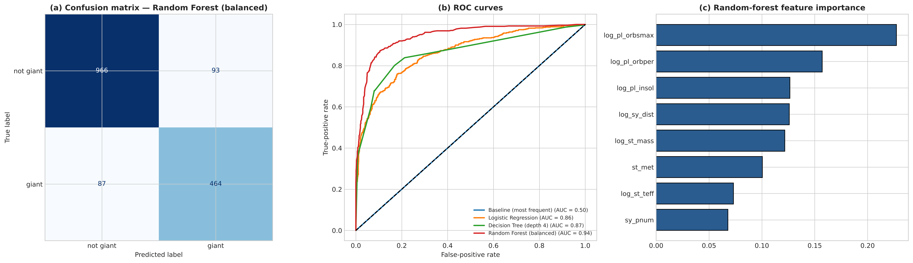
</p>
