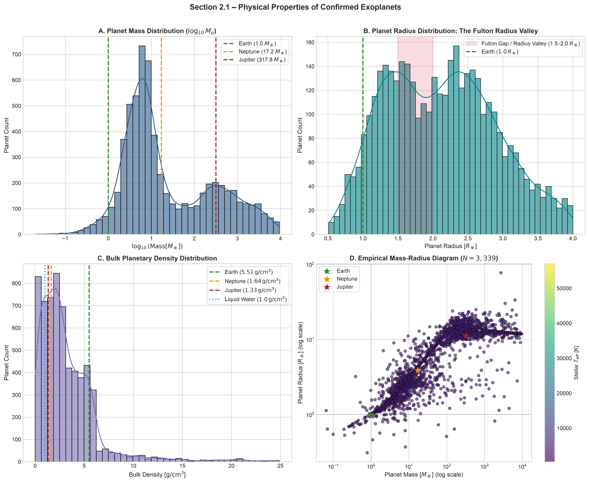
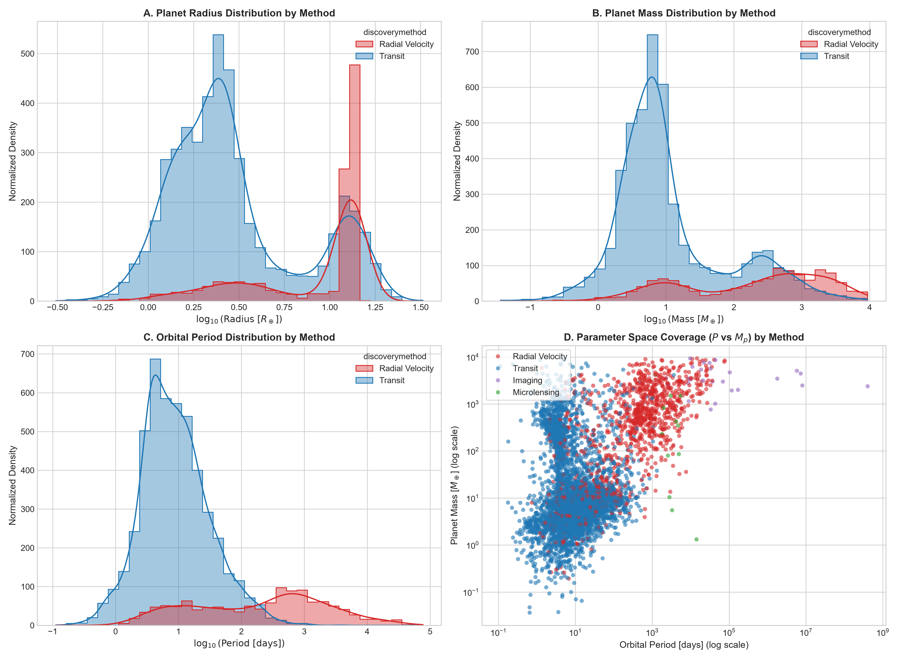
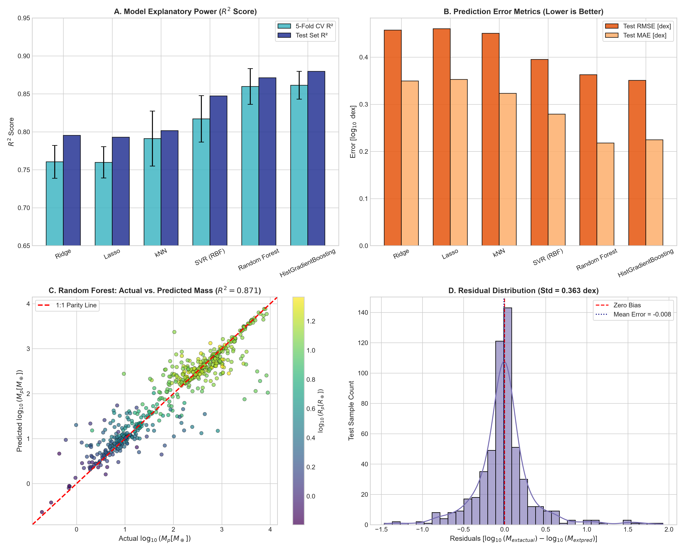
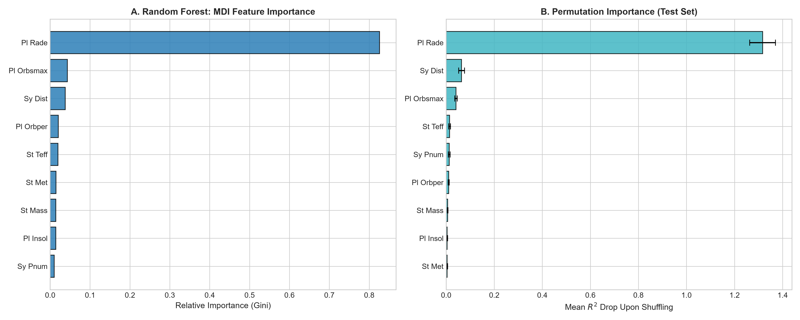
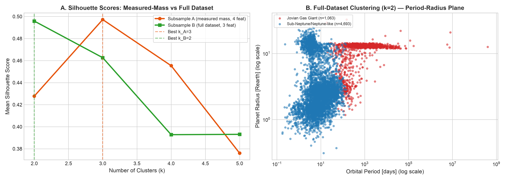
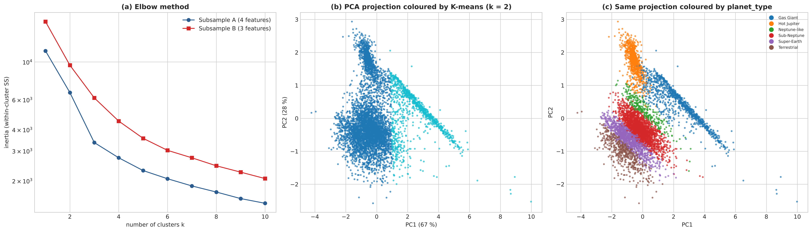

# Statistical and Machine Learning Analysis of Exoplanet Properties

An end-to-end astrophysical and machine learning investigation of **6,445 confirmed exoplanets** cataloged in the NASA Exoplanet Archive (`pscomppars` composite table).

---

## 🌟 Project Overview

This repository provides a comprehensive computational pipeline and empirical analysis spanning the physical demographics of extrasolar planets, observational selection effects, historical discovery trends, supervised predictive modeling of planetary mass, and unsupervised demographic clustering.

### 📚 Structure & Notebooks

| Notebook / Report | Focus Areas | Key Output Artifacts |
| :--- | :--- | :--- |
| **[`data_collection.ipynb`](data_collection.ipynb)** | NASA TAP API automated query; dataset suitability check (size, column types, missing values, outliers) | [`exoplanet_data.csv`](exoplanet_data.csv) (703 raw columns) |
| **[`01_data_preparation.ipynb`](01_data_preparation.ipynb)** | Feature selection, Keplerian derivations, missing value handling, mass provenance, and taxonomic classification<br>• Measurement-scale classification, range & feasibility screening, missing-data mechanism (MCAR / MAR / MNAR, Little's test), imputation comparison, transformation diagnostics | [`cleaned_exoplanet_data.csv`](cleaned_exoplanet_data.csv) (25 curated features)<br>[`figures/01_data_preparation_overview.png`](figures/01_data_preparation_overview.png) |
| **[`02_exploratory_and_detection_analysis.ipynb`](02_exploratory_and_detection_analysis.ipynb)** | **EDA, Detection Biases, Discovery Trends & Missing Data**<br>• Fulton Radius Valley (~1.5–2.0 $R_\oplus$)<br>• Period-Radius demographics & Neptune Desert<br>• Giant planet-metallicity correlation<br>• Transit vs. Radial Velocity KS/MWU hypothesis tests<br>• Space telescope eras (*Kepler*, *TESS*, *Gaia*)<br>• Systematic MNAR missingness analysis<br>• Statistical measures, outlier detection (IQR, Z-score, Mahalanobis, Isolation Forest), distribution fitting, contingency analysis, time-series diagnostics | [`figures/02_eda_physical_properties.png`](figures/02_eda_physical_properties.png)<br>[`figures/02_eda_orbital_properties.png`](figures/02_eda_orbital_properties.png)<br>[`figures/02_eda_host_star_relations.png`](figures/02_eda_host_star_relations.png)<br>[`figures/03_detection_method_comparison.png`](figures/03_detection_method_comparison.png)<br>[`figures/04_discovery_trends.png`](figures/04_discovery_trends.png)<br>[`figures/05_missing_data_analysis.png`](figures/05_missing_data_analysis.png) |
| **[`03_machine_learning_analysis.ipynb`](03_machine_learning_analysis.ipynb)** | **Machine Learning: Prediction & Clustering**<br>• Multi-model regression benchmark for planet mass $\log_{10}(M_p)$ (Ridge, Lasso, $k$-NN, SVR, Random Forest, HistGradientBoosting)<br>• Permutation feature importance & residual analysis<br>• Unsupervised $K$-Means evaluation across empirical mass ($k=3$) and full catalog ($k=2$) regimes<br>• Physical demographic cluster recovery & PCA projection<br>• Baseline & decision-tree models, feature selection (filter / wrapper / embedded), sensitivity analysis, classification metrics | [`figures/06_ml_model_comparison.png`](figures/06_ml_model_comparison.png)<br>[`figures/06_ml_feature_importance.png`](figures/06_ml_feature_importance.png)<br>[`figures/07_clustering_honest_assessment.png`](figures/07_clustering_honest_assessment.png)<br>[`figures/21_clustering_elbow_pca.png`](figures/21_clustering_elbow_pca.png) |
| **[`webapp/`](webapp)** | **ExoLens website** — search a planet by name, see its data and the ML mass estimate<br>• Flask API + animated front end, runs locally | `python webapp/app.py` → http://127.0.0.1:5000 |
| **[`FINAL_REPORT.md`](FINAL_REPORT.md)** | **Final Synthesis & Astrophysical Evaluation**<br>• Executive summary and core astrophysical patterns<br>• Observational bias modeling and selection functions<br>• ML benchmark evaluation and cluster demographics<br>• Limitations, observational horizons, and upcoming missions | Comprehensive synthesis report |
---

## 🔬 Key Scientific & Machine Learning Findings

### 1. Physical Demographics & The Fulton Valley
* **The Fulton Gap (Radius Valley)**: Small planet radii exhibit a sharp bimodal distribution with a demographic valley between **$1.5$ and $2.0\,R_\oplus$**, cleanly separating stripped rocky **Super-Earths** from volatile-rich **Sub-Neptunes**. This confirms atmospheric mass loss driven by stellar photoevaporation and core-powered mass loss.
* **The Neptune Desert**: A notable absence of intermediate-mass planets at ultra-short periods ($P < 3-5$ days), reflecting hydrodynamic envelope stripping and high-eccentricity tidal migration.
* **Core Accretion Verification**: Host stars harboring giant planets ($M_p > 100\,M_\oplus$) exhibit significantly elevated metallicity ($[Fe/H]_{\text{median}} = +0.07$ dex) compared to terrestrial hosts ($-0.01$ dex), validating core accretion theory.

<p align="center">
  
</p>

### 2. Detection Selection Biases
* **Transit vs. Radial Velocity**: Kolmogorov-Smirnov and Mann-Whitney U tests ($p < 10^{-100}$) confirm that Transit and RV samples represent distinct observational windows rather than the true galactic population.
  * *Transit*: Strongly biased toward short orbital periods (median $P \approx 7.97$ days) and small host stars due to geometric transit probability ($P_{\text{tr}} \propto 1/a$).
  * *Radial Velocity*: Biased toward massive planets (median $M_p \approx 348.8\,M_\oplus$) at wider separations (median $P \approx 305.5$ days) due to Doppler velocity semi-amplitude scaling ($K \propto M_p \sin i / \sqrt{a}$).

<p align="center">
  
</p>

### 3. Machine Learning Mass Prediction Benchmark
**What is being predicted?** The model predicts a planet's **mass** (as $\log_{10}(M_p)$, in Earth masses) from properties that are easier to measure: its **radius**, **orbital period and semi-major axis**, the **stellar flux it receives (insolation)**, and the **host star's** temperature, mass, metallicity and distance, plus the number of planets in the system. Mass is hard to measure directly (it needs radial-velocity or timing data), so a good predictor can estimate masses for the thousands of planets that only have a measured radius. Training uses only planets whose mass was actually measured.

Trained strictly on **2,796 empirical dynamical mass measurements** (preventing circular data leakage from theoretical M-R relations):

| Model | 5-Fold CV $R^2$ | Test Set $R^2$ | Test RMSE ($\log_{10}$ dex) | Test MAE ($\log_{10}$ dex) | Test MedAE ($\log_{10}$ dex) |
| :--- | :---: | :---: | :---: | :---: | :---: |
| **HistGradientBoosting** | **$0.861$** | **$0.880$** | **$0.351$** | **$0.225$** | **$0.135$** |
| **Random Forest** | **$0.860$** | **$0.871$** | **$0.363$** | **$0.218$** | **$0.107$** |
| **SVR (RBF Kernel)** | $0.817$ | $0.847$ | $0.395$ | $0.279$ | $0.192$ |
| **$k$-Nearest Neighbors** | $0.792$ | $0.801$ | $0.451$ | $0.323$ | $0.232$ |
| **Ridge Regression** | $0.761$ | $0.795$ | $0.458$ | $0.349$ | $0.288$ |
| **Lasso Regression** | $0.760$ | $0.793$ | $0.460$ | $0.353$ | $0.293$ |

* The Random Forest regressor achieves a **Median Absolute Error of $0.107$ dex** (corresponding to predicting mass within **$\sim 28\%$ relative median error**).
* **Feature Importance**: Planet radius accounts for $82.6\%$ of MDI impurity reduction ($>72\%$ permutation importance drop), with secondary contributions from stellar insolation and orbital separation.

<p align="center">
  
  <br/>
  
</p>

### 4. Unsupervised Clustering & Demographic Analysis
Unsupervised $K$-Means and GMM clustering was systematically evaluated across two distinct regimes:
* **Measured-Mass Subsample ($N=2,904$)**: Silhouette analysis identifies $k=3$ as optimal ($s=0.497$), cleanly resolving **Sub-Neptunes / Neptunes** ($N=1,168$), **Distant Cold Gas Giants** ($N=742$), and **Irradiated Hot Jupiters** ($N=994$). *Note: small rocky planets lack sufficient dynamical mass measurements in the archive to emerge as an isolated cluster.*
* **Full Photometric Catalog ($N=5,756$)**: Clustering on 3 complete parameters ($R_p, P, S$) identifies $k=2$ as optimal ($s=0.496$), capturing the overarching cosmic bifurcation into **Small Volatile Worlds** ($N=4,693$) and **Gas Giants** ($N=1,063$).

<p align="center">
  
  <br/>
  
</p>

### 5. Missing Data & Outliers
* **Missingness is not random**: Little's MCAR test rejects MCAR ($\chi^2 = 6{,}287$, 185 dof, $p \approx 0$). Missing orbital and stellar values depend on the observed discovery method and year (**MAR**), e.g. microlensing planets are $\approx 99\%$ missing in these features. MNAR cannot be tested from the data.
* **Imputation comparison** (stellar metallicity, 10% of observed values hidden and recovered): KNN (RMSE $0.159$ dex) < MICE ($0.173$) < mean / median ($0.183$). Mean / median imputation also shrinks the standard deviation ($0.189 \to 0.178$). Physics-based recovery (Kepler's law) remains the primary treatment; remaining gaps stay `NaN`.
* **Outliers**: on raw data the IQR rule flags $13$–$17\%$ of masses, periods and insolations while the Z-score flags almost none (the extreme values inflate the standard deviation); after $\log_{10}$ both rules largely agree. Mahalanobis distance and Isolation Forest agree on $203$ multivariate outliers, which are real, unusual systems and are therefore **kept**.

### 6. Distributions, Time Series & Model Diagnostics
* **Distributions**: orbital period is best described by a **log-normal** distribution (lowest AIC), which justifies the $\log_{10}$ transform; radius is bimodal, so no single unimodal distribution fits; planets per host star are *not* Poisson-distributed (planets in one system are clustered).
* **Discovery time series**: annual counts are non-stationary (ADF $p = 0.30$) and become stationary after differencing; two batch-release bursts (2014: $872$, 2016: $1{,}504$ planets) dominate the irregular component.
* **Baseline & decision tree**: a mean-predictor baseline gives $R^2 \approx 0$; a fully grown decision tree overfits (train $R^2 = 1.00$ vs. test $0.73$), the tuned tree reaches $0.84$, and Random Forest / HistGradientBoosting reach $0.87$ / $0.88$.
* **Feature selection**: planet radius and semi-major axis are selected by all five selectors; period and semi-major axis are almost collinear ($r = 0.996$, Kepler's third law) yet dropping one leaves the Random Forest CV $R^2$ unchanged ($0.860$).
* **Sensitivity analysis**: five outlier $\times$ imputation pipelines (including planets that were previously dropped as incomplete) all give CV $R^2$ between $0.84$ and $0.87$.
* **Giant-planet classification** (orbit + host-star features only): Random Forest reaches precision $0.83$, recall $0.84$, F1 $0.84$, ROC-AUC $0.94$; the majority-class baseline has $66\%$ accuracy but F1 $=0$.

## 🌐 ExoLens Web App

A local website for the project: type **one thing — a planet name** — and everything else is read or clicked.

```bash
pip install -r requirements.txt
python webapp/app.py
# then open http://127.0.0.1:5000
```
*(The first start takes about 10 seconds while the model trains. Keep the terminal open; press `Ctrl+C` to stop.)*

**Pages**
* **Search (home)** — what the site does in one sentence, a search box with live suggestions, one-click example planets, a 3-step "how it works", the six planet kinds, and a short "good to know" section.
* **Planet page** — a plain-words summary, the model's mass estimate with an 80% range (and the measured mass next to it when there is one), a to-scale size comparison with Earth and Jupiter, the facts with a short explanation of each, other planets in the same system, a map of all planets, and similar worlds.
* **Browse planets** — pick a kind (Terrestrial … Hot Jupiter), sort the list, and click any planet. Nothing to type.
* **How it works** — a short guide with a worked example of the mass estimate, how to read the map, a glossary and common questions.
* **About the model** — data source, how the estimate is made, how accurate it is and where it can be wrong.

**How it works**
* `webapp/app.py` (Flask) loads `cleaned_exoplanet_data.csv` and trains the same Random Forest as Notebook 03 (9 features, trained on the 2,796 planets with a measured mass).
* For planets that were in the training data, the page shows an **out-of-fold** prediction (that planet's own mass was hidden), so the estimate is never a memorised answer.
* If a planet has no radius, no estimate is shown; if other inputs are missing they are replaced by typical values and the page says so.
* The front end (`webapp/static/`) is plain HTML, CSS and JavaScript with a WebGL gradient background. No build step is needed. Fonts (Outfit, Allura) load from Google Fonts; without internet the site falls back to system fonts.
* The layout adapts to phones, tablets, laptops (including small windows and display scaling) and large monitors, and respects the system's "reduce motion" setting.

---

## 🛠️ Reproduction & Execution

### Prerequisites
Install the required scientific packages:
```bash
pip install -r requirements.txt
# or: pip install numpy pandas scipy scikit-learn matplotlib seaborn statsmodels missingno nbformat nbconvert ipykernel
```

### Running the Analysis
The notebooks are fully executed and reproducible:
1. **Data Collection**:
   ```bash
   jupyter notebook data_collection.ipynb
   ```
2. **Data Preparation & Cleaning**:
   ```bash
   jupyter notebook 01_data_preparation.ipynb
   ```
3. **Exploratory, Detection, Trends & Missing-Data Analysis**:
   ```bash
   jupyter notebook 02_exploratory_and_detection_analysis.ipynb
   ```
4. **Machine Learning Prediction & Clustering**:
   ```bash
   jupyter notebook 03_machine_learning_analysis.ipynb
   ```

---

## 📖 Citation & Data Attribution
Data provided by the [NASA Exoplanet Archive](https://exoplanetarchive.ipac.caltech.edu/), operated by the California Institute of Technology under contract with the National Aeronautics and Space Administration.
